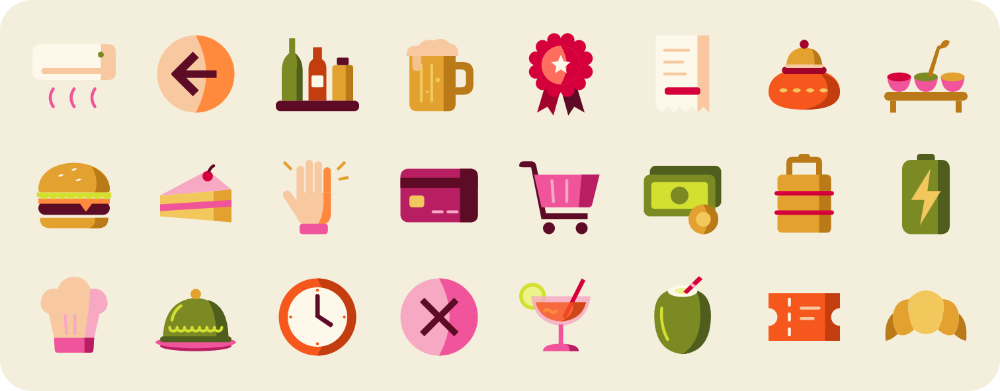
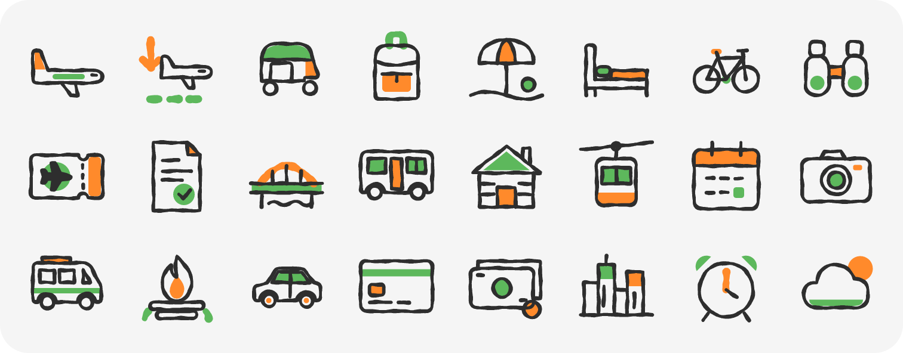
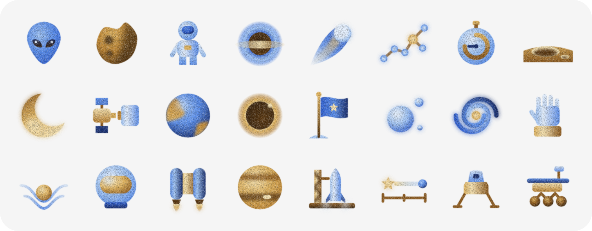

# Icon Studio

A Claude skill that designs consistent, production-ready icon sets. You give it a theme and a style (written rules, reference images, or a description); it drafts a locked rules file, draws every icon as hand-written SVG on a fixed grid, redraws each one by hand at 16 px, checks both sizes by script, reviews them at real sizes, and hands back SVG + PNG files with a browsable preview page.

The rules are the product: every number (grid, stroke, palette, shape budget) lives in one `rules.json`, so no icon invents its own.

## What's in this repo

| Path | What it is |
|---|---|
| [`icon-studio/SKILL.md`](icon-studio/SKILL.md) | The skill itself |
| [`examples/`](examples) | Three icon sets made with it: 282 icons, each with its rules and preview page |

## Install

**Claude.ai (web, desktop, mobile)**
1. Download this repo and zip the `icon-studio` folder (the zip must contain the folder, with `SKILL.md` inside it).
2. In Claude, go to **Customize → Skills**, click **+**, choose **Create skill → Upload a skill**, and upload the zip.
3. Make sure the skill is toggled on.

Skills enabled in claude.ai also sync to Claude Code when you sign in with the same account.

**Claude Code (manual)**
```bash
mkdir -p ~/.claude/skills/icon-studio
cp icon-studio/SKILL.md ~/.claude/skills/icon-studio/
```

The checking and export steps use Node with `@resvg/resvg-js`, which the skill installs when it needs it.

## How to use it

Ask for icons in plain language. Give it a theme or list, and a style:

> Make a 20-icon restaurant set. Flat two-tone shapes, no outlines, 64 px grid, at most 12 shapes per icon. Here's a reference image for the palette.

> Design travel icons in the style of this illustration: thin dark ink lines with green and tangerine accents.

What happens next:
1. **Inputs.** It asks only for what's missing, and always asks where to render: a preview page, Figma, or both.
2. **Rules.** It writes `rules.json` and a human-readable `RULES.md`, including a do-not-copy list for your references (it takes the look, never the subject).
3. **Anchors.** It draws 4 hard icons first (round, tall, layered, symbolic) for you to review. Once they pass, the rules are locked.
4. **The set.** It draws in batches of 6–8, lints each one against the rules and reviews contact sheets in light, dark and silhouette.
5. **16 px versions.** Each icon is redrawn, not scaled, on its own 16 px grid with a lighter stroke and a smaller shape budget, so it stays sharp at small sizes. It keeps the same metaphor and silhouette as its 24 px master and never gains detail. A pair sheet shows each 16 px icon next to its master to check they match. Say "no 16 px" if you don't need them.
6. **Delivery.** SVGs at both sizes, PNGs, contact sheets and the rules in one zip, plus a preview page where you can resize icons, switch between 24 px and 16 px, change backgrounds, check padding and silhouettes, and copy any SVG. "Copy all" pastes the whole set into Figma as a grid of named frames. In Figma, both sizes become variants of one component.

To revise, just name the icon and the problem ("the croissant looks broken"). It changes only what you mention, and a changed icon gets its 16 px version redrawn too. If the feedback is really about a rule ("everything feels heavy"), it proposes a rule change and re-checks the whole set.

**Tips**
- Written rules give the most predictable sets. Numbers beat adjectives: "at most 10 shapes" works better than "simple".
- "When unsure, use the fewest parts" is a good rule to keep in any style.
- Check a few icons on a real device; the skill only sees renders.

## Examples

Each folder has the SVGs (`icons/`), the locked rules (`RULES.md`) and the preview page (`index.html`). These sets were made before the 16 px variant was added, so they include their master size only.

### Restaurant Folk Icons · 128 icons
Flat, two-tone icons on a 64 px grid in a hand-painted Indian-folk palette: food, drinks, dietary tags, ordering and payment, amenities and more.



[Icons](examples/restaurant-folk-icons/icons) · [Rules](examples/restaurant-folk-icons/RULES.md) · [Live preview](https://arundhuti00.github.io/icon-studio/examples/restaurant-folk-icons/)

### Travel Ink Icons · 90 icons
Hand-drawn dark grey ink on a 48 px grid, each icon with one leaf green and one tangerine accent: luggage, transport, stays, landmarks, weather and more.



[Icons](examples/travel-ink-icons/icons) · [Rules](examples/travel-ink-icons/RULES.md) · [Live preview](https://arundhuti00.github.io/icon-studio/examples/travel-ink-icons/)

### Celestial Glass Icons · 64 icons
Grainy, softly blended space icons in golden browns and ceramic blues on a 64 px grid: planets, spacecraft, astronaut gear, science and a few sci-fi characters.



[Icons](examples/celestial-glass-icons/icons) · [Rules](examples/celestial-glass-icons/RULES.md) · [Live preview](https://arundhuti00.github.io/icon-studio/examples/celestial-glass-icons/)

Celestial uses SVG filters for grain and blur. Browsers render them; Figma keeps the blur but drops the grain.

## License

MIT. Free to use the skill and the example icons in personal and commercial work. See [LICENSE](LICENSE).

Made by [Arundhuti](https://github.com/Arundhuti00).
